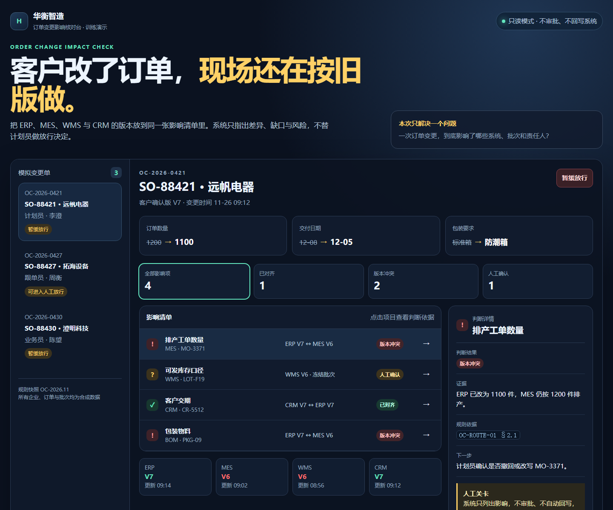

# 华衡智造订单变更影响核对台

一个面向制造业订单变更场景的小切口 FDE Demo。

系统把订单数量、交期和包装要求的变更集中展示，并核对 ERP、MES、WMS、CRM 的版本状态，帮助计划员识别版本冲突、冻结库存风险和需要人工确认的事项。

> 本项目只生成只读影响清单，不审批订单、不自动改写业务系统，也不替代人工放行。

## 在线体验

- [公开 Demo](https://sonnyboy061117-cmd.github.io/huaheng-order-change-impact-demo/)
- [完整暂存仓库](https://github.com/sonnyboy061117-cmd/huaheng-order-change-impact-demo)
- [目标仓库 Issue #1](https://github.com/gaojiayi0625/FDE/issues/1)
- [贡献 PR #2](https://github.com/gaojiayi0625/FDE/pull/2)

## 功能范围

- 切换三条合成订单变更案例
- 对比数量、交期和包装要求的前后差异
- 查看 ERP、MES、WMS、CRM 的版本与更新时间
- 标记已对齐、版本冲突和必须人工确认的影响项
- 对“冻结批次计入可发数量”执行拦截
- 展示证据、规则依据和下一步责任人

## 项目资料

- `index.html`：Demo 入口
- `docs/华衡订单变更-案例分析.md`：案例分析
- `prompts/华衡订单变更项目主提示词.md`：项目提示词
- `ai-collaboration/AI协作记录.md`：脱敏 AI 协作记录
- `deliverables/huaheng-order-change.zip`：原始案例资料包
- `docs/evidence/`：Issue 与在线站点证据

## 数据说明

所有公司、人物、订单、批次和数量均为合成训练内容，不包含真实生产数据或商业机密。
